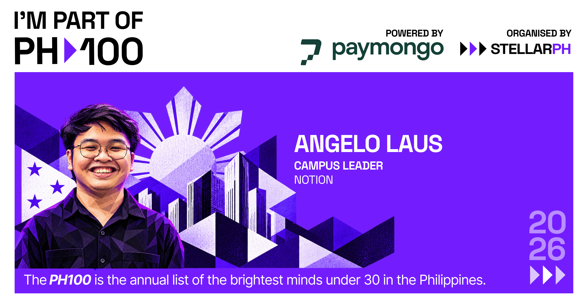

  

# Angelo Laus

I'm @gelolaus, a builder and community leader from the Philippines.

My active roles:

- [Notion](https://notion.com) for Startups Partner, Templates Creator, and Campus Leader (Cohort 4)
- [Sip & Scale](https://sipnscale.com/) Partnerships
- [JPCS-APC](https://instagram.com/jpcs.apc) VP for External Affairs

Things I've built:

- [Wantap (2026)](https://wantap.cc) – Digital calling card platform with custom dynamic routing.
- [Eypi (2026)](https://eypi.cc) – Unified campus suite for student org links, forms, and ticketing.
- Homelab (2026) – Self-hosted infrastructure for private cloud storage and network security.

Connect with me on [Instagram](https://instagram.com/gelolaus) or [LinkedIn](https://linkedin.com/in/gelolaus), or email [hello@gelolaus.com](mailto:hello@gelolaus.com).

  

Recognized as part of [StellarPH's PH100 Cohort](https://stellarph.io/programs/ph100/2026) for 2026.
